# Preemptive Execution — Architectural and Contextual Diagrams

**Crate:** `atlas-smr-preemptive-execution` and everything around it.
**Scope:** where preemptive execution sits in the Atlas ecosystem, what it plugs into, how a
batch travels through a replica, how threads and channels are laid out in each of the three
executors, and how the variants are compared experimentally.

The *internals* of the three executors are documented in the sibling documents
([00](../00-common-substrate.md), [01](../01-dual-state-executor.md),
[02](../02-crud-cache-executor.md), [03](../03-scalable-crud-executor.md)). They are the trusted
baseline here; this document does not repeat their data-structure tables or cost models. Where
the code disagrees with them, §12 says so.

The ordering protocol is treated throughout as a member of a **family**: any round-based BFT
ordering protocol that knows a batch's order (its proposal is accepted) before it commits that
batch. That gap is what preemptive execution fills; no diagram depends on a particular protocol.

| # | Diagram | Question it answers | Width (px) |
|---|---|---|---|
| L | `preemptive-context-legend` | What do the shapes and lines mean? | 753 |
| D1 | `preemptive-context-system` | Which modules must the executor agree with? | 956 |
| D2 | `preemptive-context-crates` | Where does the crate sit in the build graph? | 968 |
| D3a | `preemptive-context-replica-ingress` | How does a request reach the executor, and where is the path chosen? | 792 |
| D3b | `preemptive-context-replica-egress` | How do replies, checkpoints and state installs leave and enter? | 704 |
| D4 | `preemptive-context-critical-path` | Which span leaves the critical path, and which metric measures each span? | 416 |
| D5 | `preemptive-context-concurrency` | Threads, pools, channels and state ownership, all three executors | 969 |
| M1 | `preemptive-context-module-dual-state` | Every type, thread and channel of the dual-state executor | 1469 |
| M2 | `preemptive-context-module-crud-cache` | Every type, thread and channel of the CRUD cache executor | 1168 |
| M3 | `preemptive-context-module-scalable-crud` | Every type, thread and channel of the scalable CRUD executor | 1164 |
| D6 | `preemptive-context-experiment` | How the variants are built, run and measured | 1178 |

Widths are at PlantUML's default scale. For a two-column venue: D4 fits a single column; D3a,
D3b and the legend fit a double-column (`figure*`) span; D1, D2, D5, M2, M3 and D6 fit `figure*`
at reduced size; M1 is the densest and is best used whole-page or cropped to one path.

Focused deep-dives, one component at a time:

* [crud-cache-visuals.md](crud-cache-visuals.md) — how the CRUD cache stores speculative state
  (confirmed state, pending-write cache, per-batch write log): eight draft figures in different
  styles, PlantUML and matplotlib, over one shared running example.

---

## 0. Visual vocabulary

All diagrams are grayscale-safe: meaning is carried by shape and line style, never by colour.

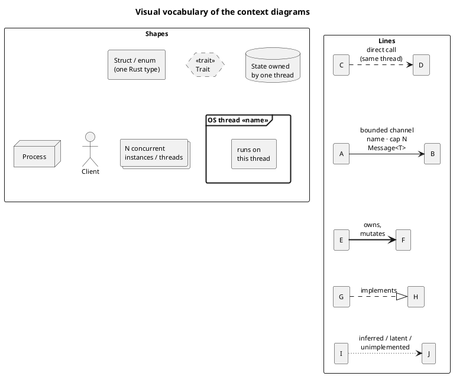

Conventions:

* **One figure per Rust type or trait.** A rectangle is one struct or enum from the code, with
  its real name; a dashed hexagon is one trait. `«fn»` marks free functions shown because they
  do the work on a path.
* **Channels are the arrows.** Every bounded channel is drawn as a solid arrow from the sender
  to the receiver, labelled `name · capacity` and the message type. A channel with several
  producers is drawn once per producer, with the same name.
* **Threads are bold frames** named exactly as `std::thread::Builder::name` names them.
* **Stacked shapes mean concurrency.** A stack is either a pool of OS threads or *N* instances
  of one type running concurrently (e.g. one `ParallelExecutionUnit` per operation). Every pool
  in these executors is used **fork-join**: the owning thread calls `ThreadPool::install` and
  blocks until the pool finishes, so a pool adds parallelism *inside* one step of its owner, it
  does not add an independent consumer.
* **Letters and numbers on arrows** name a path; each diagram's legend spells the path out.
* Structural diagrams use `linetype polyline` rather than the `ortho` of `../diagrams/`:
  with channels drawn as labelled arrows, ortho routing placed the labels on top of each
  other. This is the only deliberate departure from the existing style.

---

## 1. Four facts that shape every diagram

1. **Speculation is driven from outside the executor.** A round-based protocol emits a
   decision in parts. `DecisionPart::DecisionRequests` carries the batch once the proposal is
   accepted; `DecisionPart::DecisionDone` marks the commit
   (`Atlas/Atlas-Core/src/ordering_protocol/decision.rs:295-304`). The replica's decision log
   turns the first into `queue_preemptive_update` and the second into
   `queue_preemptive_update_finalized`
   (`Atlas/Atlas-SMR-Replica/src/server/decision_log/mod.rs:577-629`). The executor only sees
   the gap if the protocol emits the first part before the second.
2. **The preemptive path is chosen by Rust specialization in the decision log, not in the
   executor.** `DecisionLogManagement` has a `default fn` implementation that calls
   `queue_update` after commit (`decision_log/mod.rs:480-549`) and a specialized one, bounded on
   `EX: TPreemptiveExecutorDecisionHandle + TPreemptiveExecutorStateHandle`
   (`decision_log/mod.rs:551-638`). `SMRExecWrapper<E>` only supplies those two traits with
   ordinary impls (`Atlas/Atlas-SMR-Core/src/execution/mod.rs:146-167`).
3. **All requests to an executor share one FIFO channel.** Speculative batches, commits,
   never-speculated batches, reads and state-transfer polls all travel on the
   16384-slot work channel of `PreemptiveExecutionRequest<O>` (`src/exec_handle.rs:11-39`;
   capacities `single_threaded_crud/mod.rs:41`, `scalable_crud/mod.rs:39`,
   `single_thread_double_state/mod.rs:35`). A commit therefore queues behind any speculative
   batches already in the channel. That queueing is exactly what
   `CONFIRM_ENQUEUE_TO_APPLY_LATENCY` measures.
4. **Replies leave on a shared pool, not on the executor thread.** Every executor hands its
   `ReplyBatch` to `ReplicaReplier::execution_finished`, which sends on the global
   `atlas_common::threadpool` (`Atlas/Atlas-SMR-Execution/src/repliers.rs:43-130`, the
   `threadpool::execute` call at `:65`).

---

## D1 — System context

Preemptive execution is one module of a running replica, reached only through traits. The
diagram shows everything the executor must agree with, and that the post-commit executor is the
interchangeable alternative behind the same `TExecutor` + `TMonolithicStateExecutor` pair.

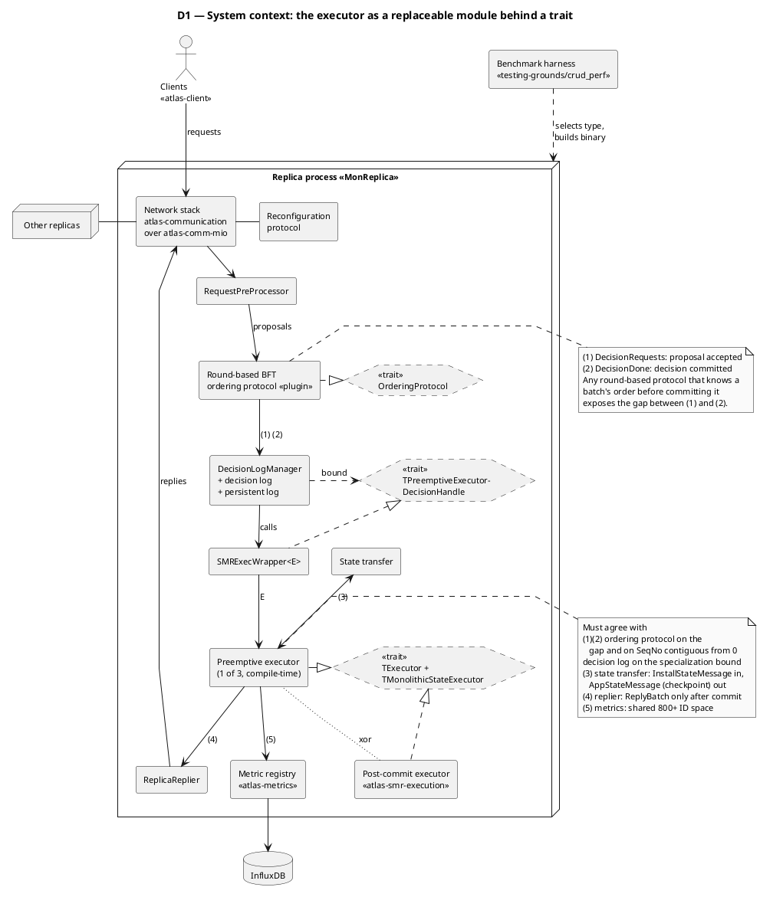

**Evidence.** Replica wiring: `Atlas/Atlas-SMR-Replica/src/server/monolithic_server/mod.rs:123-147`
(`ME::init_handle`, `SMRExecWrapper(..)`, `ME::init(..)` returning the install/checkpoint pair).
Executor selectors implement `TExecutor`/`TMonolithicStateExecutor`: `src/lib.rs:29-153`.
Replies through `ReplicaReplier`: `src/lib.rs:11,55,101,146`. State-transfer channels:
`monolithic_server/state_transfer.rs:65-96`. Agreement on `SeqNo` contiguous from 0:
[00 §4](../00-common-substrate.md#4-sequence-number-discipline). Metrics ID space:
`src/metric.rs`.

---

## D2 — Crate view

The workspace layering with the crate in place. Three things to read off it:

* **Layer and dependencies.** The crate sits in L4 and depends on `atlas-smr-core`,
  `atlas-smr-application`, `atlas-core`, `atlas-metrics`, `atlas-common` and
  `atlas-smr-execution` (`Cargo.toml`).
* **Alternative *and* dependency.** `atlas-smr-execution` is the mutually exclusive
  alternative as the replica's executor (edge g), and at the same time a dependency for two
  unrelated reasons, drawn as two separate edges. (c) is the CRUD trait family, re-exported at
  `src/lib.rs:17` so applications need not depend on the baseline crate. (d) is the replier
  that sends every client reply. The replica itself also links `atlas-smr-execution` (edge f),
  so every preemptive binary contains both execution crates.
* **Cross-repo contract.** The ordering-protocol plugins depend only on
  `atlas-common`/`core`/`communication`/`metrics`. None of them uses this crate's API; their
  contract with preemptive execution is *when* they emit `DecisionPart::DecisionRequests`
  (edge h). The only consumers of this crate's API are in `testing-grounds`.

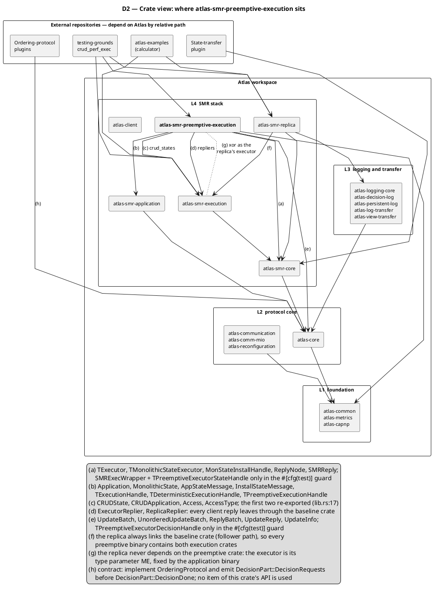

**Evidence.** Intra-workspace edges from `cargo metadata --no-deps` in `Atlas/`. Imports per
edge from `grep` over `src/` (every item listed in the legend is imported somewhere under
`src/`). Plugin path dependencies: `febft/febft-pbft-consensus/Cargo.toml`,
`hot-iron-oxide/Cargo.toml`, `IronDumbo/Cargo.toml`. The state-transfer plugin also depends on
`atlas-smr-core` and `atlas-smr-application` (`febft/febft-state-transfer/Cargo.toml`).
`testing-grounds/crud_perf/crud_perf_exec/Cargo.toml` depends on both execution crates
unconditionally. `atlas-examples/calculator/*/Cargo.toml` depend on `atlas-smr-execution` and
`atlas-smr-replica` only, through `../../../Atlas-*` paths that resolve only when the
repository is checked out as the `Atlas/Atlas-Examples` submodule (`Atlas/.gitmodules`).

---

## D3 — Replica integration

One batch from arrival to reply. The diagram is split at the executor's work channel so that
each half fits a double-column figure: D3a ends where D3b begins.

### D3a — ingress, and the specialization bridge

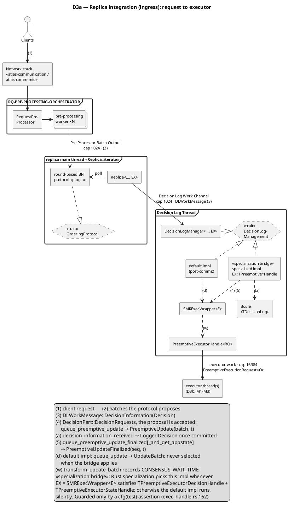

**Evidence.** Pre-processor threads and the 1024-slot output channel:
`Atlas/Atlas-SMR-Core/src/request_pre_processing/mod.rs:43,458-505`. The replica main loop polls
the protocol and forwards `DecisionInformation`: `Atlas/Atlas-SMR-Replica/src/server/mod.rs:644-721,978-1007`.
Decision Log Thread and its 1024-slot work channel: `decision_log/mod.rs:58,159-174`.
Both call sites: `decision_log/mod.rs:578-590` (speculate) and `:619-629` (commit).
The specialized impl vs the default one: `decision_log/mod.rs:498,515` (`default fn`) and
`:551-567` (bound). `transform_update_batch` records `CONSENSUS_WAIT_TIME`:
`Atlas-SMR-Core/src/execution/mod.rs:57-73`. Handle sends: `src/exec_handle.rs:116-151`.
Guard: `src/exec_handle.rs:162-187`.

**The bridge fails silently, and the guard only runs under `cargo test`.** If
`SMRExecWrapper<PreemptiveExecutorHandle<_>>` stops satisfying the two traits, the default
impl is selected, and every preemptive executor receives only `UpdateBatch` (commit-time)
requests. It still builds, runs, and reports plausible numbers. The guard module is
`#[cfg(test)]` (`src/exec_handle.rs:162`), so it breaks `cargo test` builds, not `cargo build`.
The runtime check is `SPECULATION_HIT_RATE` pinned at 0.

### D3b — egress, state transfer and the other producers

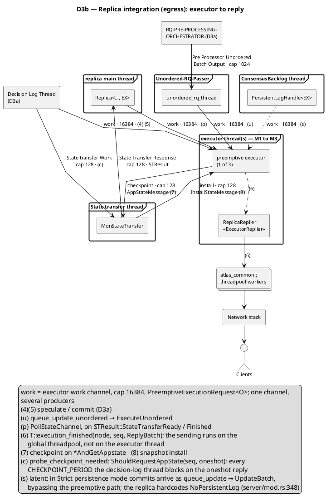

**Evidence.** Unordered passer thread: `Atlas-SMR-Replica/src/server/unordered_rq_handler.rs:10-28`.
`PollStateChannel` on `StateTransferReady`/`Finished`: `server/mod.rs:850-866`.
State-transfer work/response channels (128 each): `server/state_transfer.rs:21-22,79-91`.
`ShouldRequestAppState` + oneshot: `server/state_transfer.rs:32`, `decision_log/mod.rs:427-451`.
Checkpoint consumer: `monolithic_server/state_transfer.rs:140`. Strict-mode bypass:
`Atlas-Persistent-Log/src/lib.rs:98-111,516-529`, `Atlas-Persistent-Log/src/backlog/mod.rs:157-162`,
`Atlas-SMR-Replica/src/persistent_log/mod.rs:89-95`. The hardcoded `NoPersistentLog`:
`server/mod.rs:348`. Reply pool: `Atlas-SMR-Execution/src/repliers.rs:65`.

---

## D4 — Critical path: one batch, one clock

The paper's central figure. Time runs downward; the four lanes share one clock. The
post-commit executor starts work only at the commit. The preemptive executor starts at proposal
acceptance, holds the replies, and at the commit only pops them (dual-state) or applies a
pre-computed delta (cache executors). Span **B**, the batch execution, leaves the critical path;
span **A**, the queueing plus pop/apply, stays on it. The dual-state executor's second execution
happens on the confirmed worker *after* the replies are dispatched (lane 4).

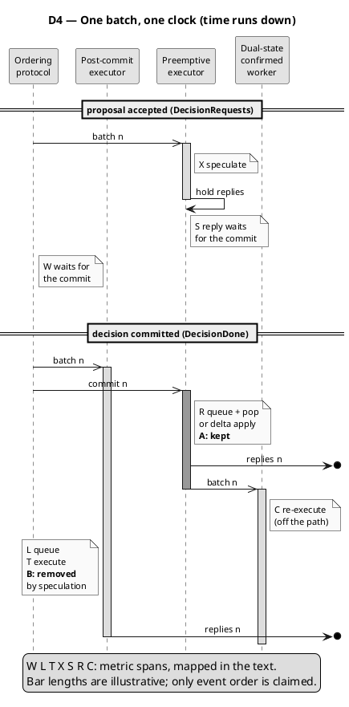

| Tag | Metric | From → to | Recorded at |
|---|---|---|---|
| W | `CONSENSUS_WAIT_TIME` (both) | batch stamped when requests become known → batch converted for the executor. Post-commit: ≈ one consensus round trip. Preemptive: ≈ 0 | stamp `Atlas-Core/src/ordering_protocol/decision.rs:558`; record `Atlas-SMR-Core/src/execution/mod.rs:63-65` |
| L | `EXECUTION_LATENCY` | commit queued → dequeued | stamp `Atlas-SMR-Execution/src/exec_handle.rs:83`; record `…/single_threaded/monolithic_executor/mod.rs:127` |
| T | `EXECUTION_TIME_TAKEN` | batch execution | `Atlas-SMR-Execution/src/single_threaded/mod.rs:40` |
| X | `DS_` / `CACHE_` / `SCALABLE_PREEMPTIVE_EXECUTION_TIME` | speculative execution of the batch | `preemptive_requests.rs:258`, `single_threaded_crud/pending_state.rs:214`, `scalable_crud/pending_state.rs:304` |
| (Q) | `CACHE_ENQUEUE_TO_EXECUTE_LATENCY` (CRUD cache only; not drawn) | `PreemptiveUpdate` queued → dequeued | `single_threaded_crud/mod.rs:251` |
| S | `DS_` / `CACHE_` / `SCALABLE_SPECULATION_TO_CONFIRM_LATENCY` | replies ready (`speculated_at`) → commit processed | set `preemptive_requests.rs:51`, `single_threaded_crud/pending_state.rs:223`, `scalable_crud/pending_state.rs:301`; recorded `preemptive_requests.rs:378`, `single_threaded_crud/pending_state.rs:303`, `scalable_crud/pending_state.rs:384` |
| R | `CONFIRM_TO_REPLY_TIME` | commit queued → replies handed to the replier. Same two points as L + T | `src/metric.rs:192-201` (`record_confirmation`) |
| (R₁) | `CONFIRM_ENQUEUE_TO_APPLY_LATENCY` | queueing part of R | e.g. `single_threaded_crud/mod.rs` confirmation arms, `preemptive_worker/mod.rs:140` |
| (R′) | `CONFIRM_BLOCKED_ON_EXEC_TIME` | R restricted to misses; grows back towards L + T | `src/metric.rs:198-200` |
| C | `CONFIRMED_WORKER_LATENCY` then `CONFIRM_EXECUTION_TIME` (dual-state) | re-execution on the confirmed worker, after the reply | `confirmed_worker/mod.rs:210`, `confirmed_requests.rs:45` |

Two caveats a reader of the figure should have:

* **Bar lengths are illustrative.** The figure claims only the order of events. Every duration
  in the table is a per-second Welford mean by the time it reaches InfluxDB
  (`testing-grounds/crud_perf/README.md`, *Running and analysing*).
* **A stays on the critical path because of fact 3.** The commit shares the FIFO work channel
  with speculation, so if speculation is behind, R₁ absorbs it. On a speculation miss the
  executor degrades to direct execution, and R becomes R′ ≈ L + T
  ([00 §5](../00-common-substrate.md#5-out-of-order-delivery-and-the-reorder-buffer)).

---

## D5 — Concurrency and ownership, side by side

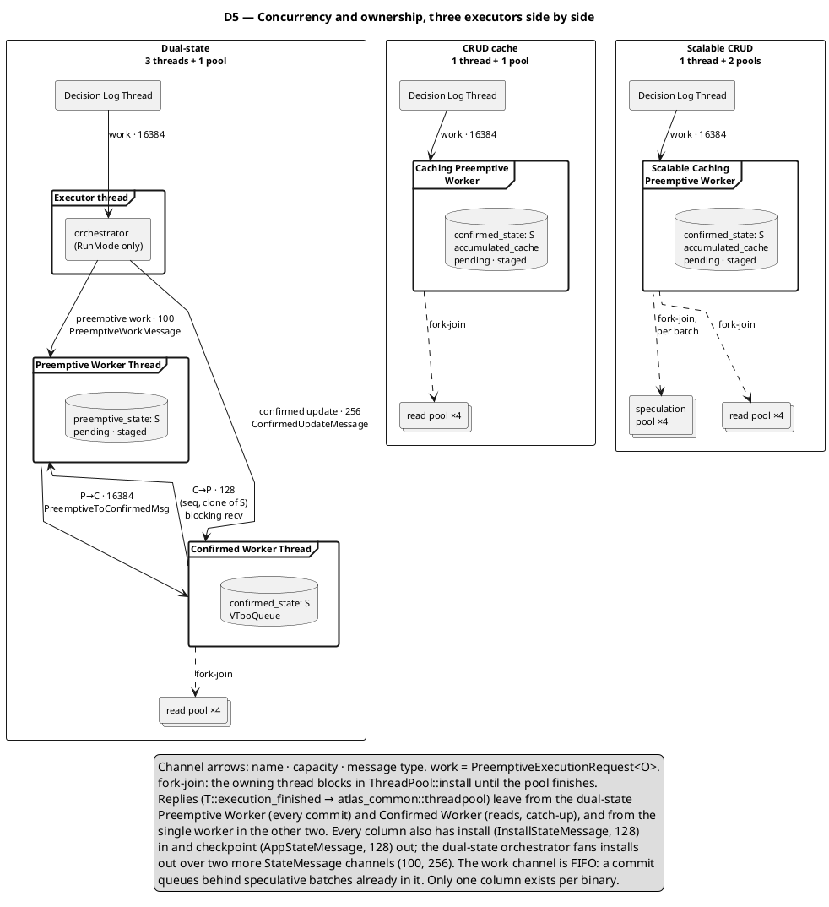

| | Dual-state | CRUD cache | Scalable CRUD |
|---|---|---|---|
| OS threads | 3: `Executor thread`, `Preemptive Worker Thread`, `Confirmed Worker Thread` | 1: `Caching Preemptive Worker` | 1: `Scalable Caching Preemptive Worker` |
| Pools (fork-join) | read ×4, owned by the confirmed worker | read ×4 | speculation ×4 (owned by `ScalableCachingPreemptiveState`) + read ×4 |
| Who owns state | preemptive worker: `preemptive_state: S`; confirmed worker: `confirmed_state: S` | the worker: `confirmed_state` + `accumulated_cache` + pending + staged | same as CRUD cache |
| Cross-thread state transfer at run time | backtrack: full clone of `S` over C→P, receiver blocks | none | none. Speculation-pool threads read `&S` and `&AccumulatedCache` concurrently (`S: Sync`) |
| Threads that reply | preemptive worker (commits); confirmed worker (reads, catch-up) | worker | worker |

**Evidence.** Thread names: `single_thread_double_state/mod.rs:136`,
`preemptive_worker/mod.rs:57`, `confirmed_worker/mod.rs:112`, `single_threaded_crud/mod.rs:151`,
`scalable_crud/mod.rs:159`. Capacities: `single_thread_double_state/mod.rs:35-36`,
`preemptive_worker/mod.rs:32`, `confirmed_worker/comm_handles.rs:12`,
`single_thread_double_state/comm_handles.rs:63-73`, `single_threaded_crud/mod.rs:41-43`,
`scalable_crud/mod.rs:39-44`. Pool sizes and owners: `confirmed_worker/mod.rs:33,61`,
`single_threaded_crud/mod.rs:105`, `scalable_crud/mod.rs:92-113`,
`scalable_crud/pending_state.rs:88,225`. Fork-join: every pool is used via `install`
(`single_threaded_crud/mod.rs` `ExecuteUnordered` arm, `scalable_crud/pending_state.rs:225`,
`confirmed_requests.rs` `execute_read`). Blocking backtrack round trip:
`preemptive_worker/comm_handles.rs:106`.

---

## M1 — Dual-state executor, inside

Every type, thread and channel of `single_thread_double_state`. The orchestrator owns no state
and only routes: speculation, commits and never-speculated batches go to the preemptive worker;
reads go to the confirmed worker; state installs fan out to both. The preemptive worker sends
the client replies on every commit, then forwards the batch for re-execution on the confirmed
state.

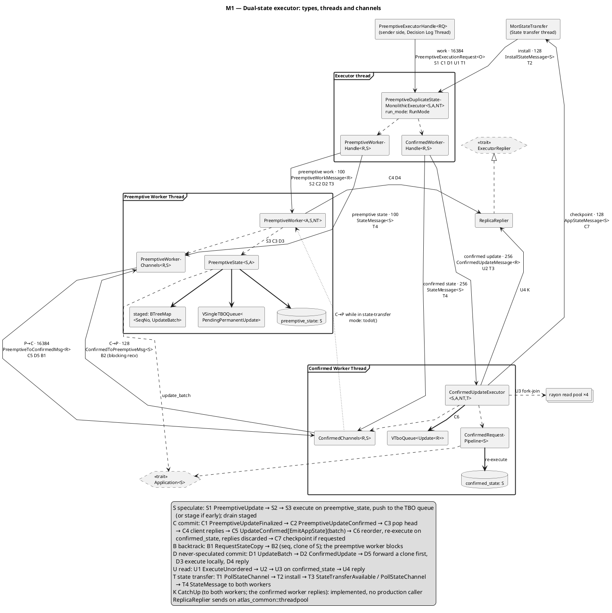

**Evidence.** Orchestrator struct and routing: `single_thread_double_state/mod.rs:44-58,226-285`.
Worker handles: `preemptive_worker/comm_handles.rs:35-40`, `confirmed_worker/comm_handles.rs:45-51`.
Channel-owning structs: `PreemptiveWorkerChannels` (`preemptive_worker/comm_handles.rs:56`),
`ConfirmedChannels` (`confirmed_worker/comm_handles.rs:74`). Preemptive worker dispatch:
`preemptive_worker/mod.rs:92-123`. Commit path, replies before forwarding:
`preemptive_worker/mod.rs:98-101,131-148`. Never-speculated commit, clone forwarded first:
`preemptive_worker/mod.rs:213-245`. Confirmed worker loop, priority `try_recv` and select:
`confirmed_worker/mod.rs:145-177`; re-execution and checkpoint: `:204-236`; `RequestStateCopy`:
`:285-291`. The `todo!()`: `preemptive_worker/mod.rs:197-205`. `CatchUp` routed to both workers:
`single_thread_double_state/mod.rs:229-240`; the confirmed worker replies:
`confirmed_worker/mod.rs:313-333`; the preemptive worker does not:
`preemptive_requests.rs:297-307`.

---

## M2 — CRUD cache executor, inside

One thread does everything ordered. Speculation runs the application through a per-batch
`CachingState` proxy that reads `&confirmed_state` and the `AccumulatedCache` and writes only
to its own delta. A commit applies that delta. The only other threads are the read pool, which
sees `&confirmed_state` only, and the reply pool.

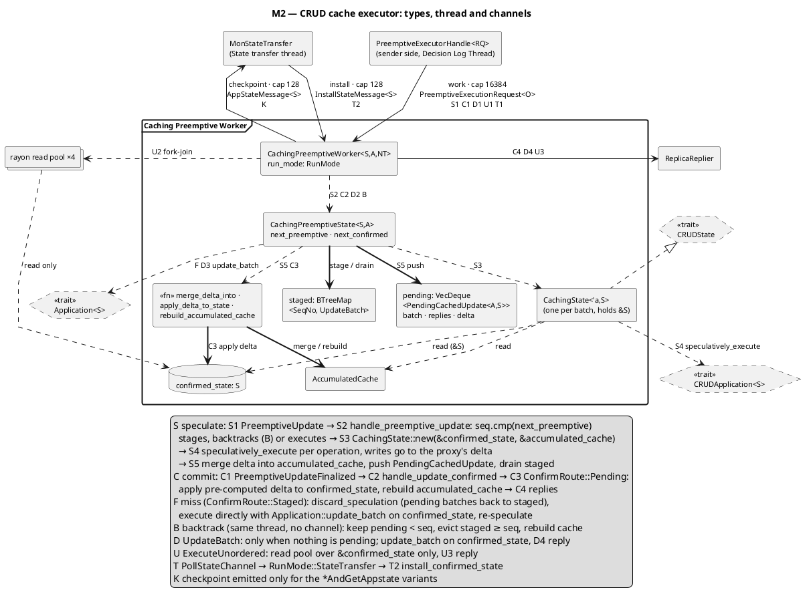

**Evidence.** Worker struct and spawn: `single_threaded_crud/mod.rs:120-155`. Dispatch on every
`PreemptiveExecutionRequest` variant: `single_threaded_crud/mod.rs:199-320`. Admission and
speculation: `single_threaded_crud/pending_state.rs:198-230`. Commit routes (`Pending`,
`Staged`, `Mismatch`, `Empty`): `pending_state.rs:235-290`. Miss path: `execute_directly` `:326`,
`discard_speculation` `:348`. Backtrack: `:422`. Checkpoint only on `*AndGetAppstate`:
`mod.rs:359` and its two callers. Read pool: `mod.rs:105-107` and the `ExecuteUnordered` arm.

---

## M3 — Scalable CRUD executor, inside

M2 plus a second pool. The commit, backtrack, miss, read and state-transfer paths are
identical to M2; only speculation changes. The worker thread forks one
`ParallelExecutionUnit` per operation onto the speculation pool. The units read the same base
concurrently and log every access. After the join, the worker computes collisions, keeps the
non-colliders' deltas, and re-executes colliders sequentially through M2's `CachingState`.

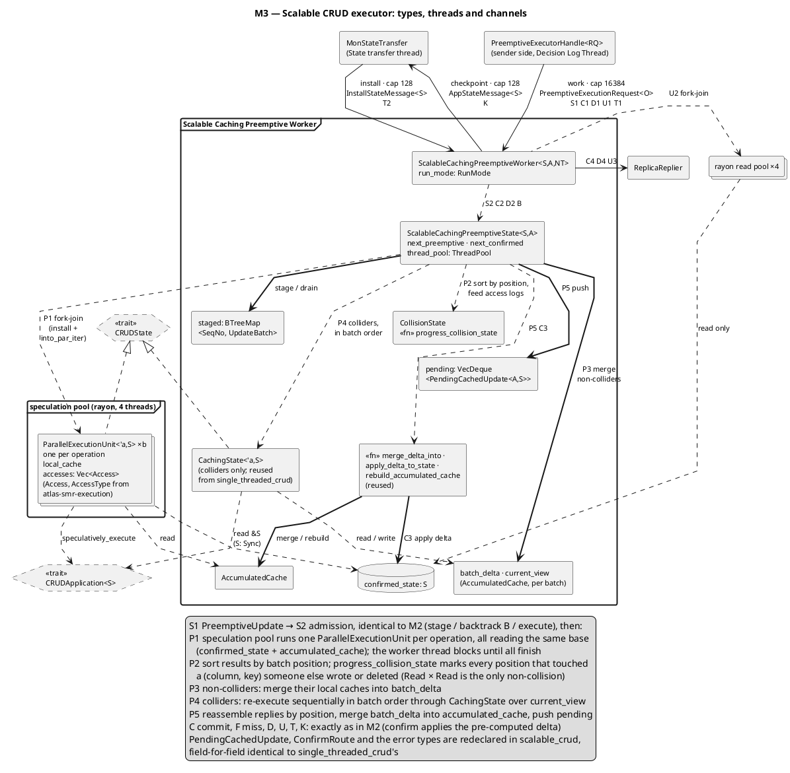

**Evidence.** Worker and pools: `scalable_crud/mod.rs:39-44,91-113,127-160`. State with
`thread_pool`: `scalable_crud/pending_state.rs:74-107`. Five-step pipeline:
`scalable_crud/pending_state.rs:197-305`, fork at `:225`. Unit and access log:
`scalable_crud/execution_unit.rs:17-30`; the manual `Send` (the crate's only `unsafe`) at
`:30`. Collision index: `execution_unit.rs:133-168`. Redeclared types:
`scalable_crud/pending_state.rs:45` (`PendingCachedUpdate`) and the `ConfirmRoute` at `:328-331`,
vs `single_threaded_crud/pending_state.rs`. Detailed walk-through:
[03 §5](../03-scalable-crud-executor.md#5-the-five-step-speculative-pipeline).

---

## D6 — Experimental context

How the four variants are compared: one harness binary, one executor compiled in, everything
else shared by construction, one metric path to InfluxDB tagged with the variant name.
Deployment topology is out of scope here.

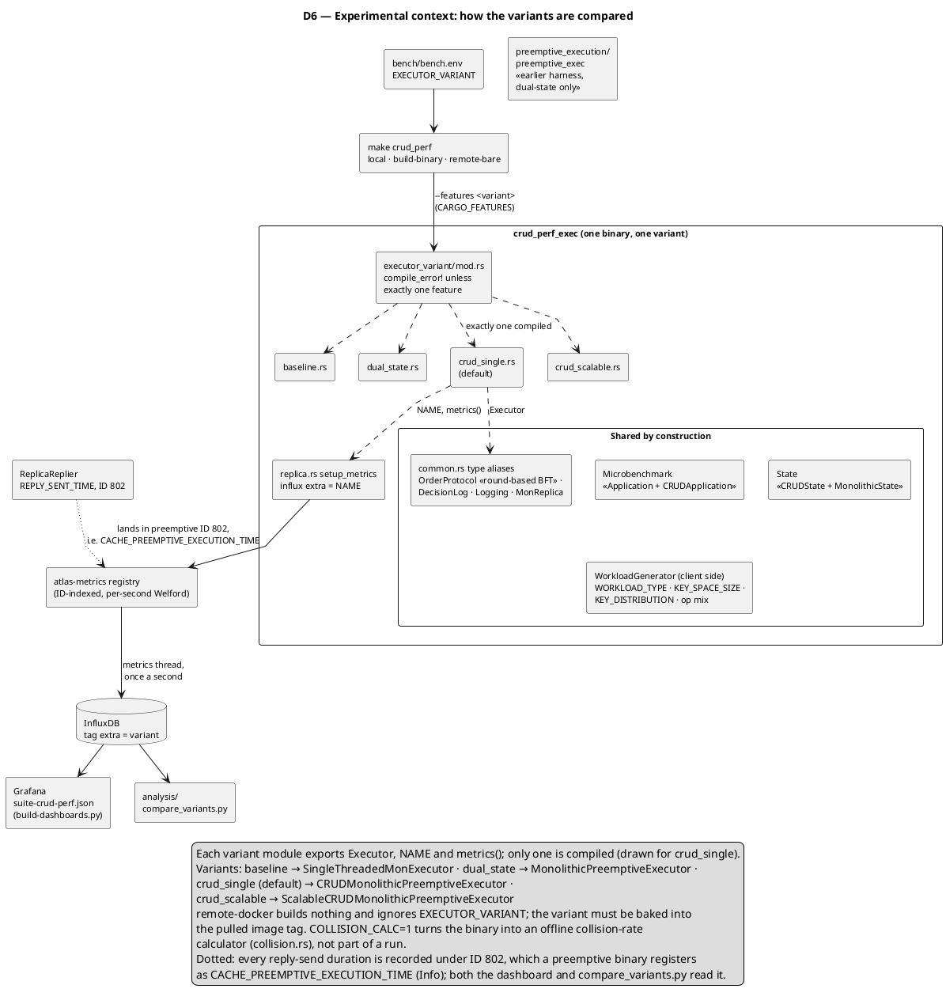

The module doc-comment of `executor_variant/mod.rs` states the methodology:

> Everything the variants share -- the application, the workload generator, the protocol
> stack, the configuration -- lives outside this module and is compiled identically for all
> of them. That is deliberate: this harness exists to compare executors, so anything that
> could drift between variants would quietly invalidate the comparison.

**Evidence.** Feature exclusivity: `testing-grounds/crud_perf/crud_perf_exec/src/executor_variant/mod.rs:21-72`
and `Cargo.toml` `[features]`. Variant modules: `executor_variant/{baseline,dual_state,crud_single,crud_scalable}.rs`.
Shared aliases: `src/common.rs` (`OrderProtocol`, `DecisionLog`, `Logging`, `SMRReplica`,
`Executor` re-export). Application and state: `src/exec.rs:21,31,104`, `src/serialize/mod.rs:77,101,131`.
Workload generator on the client: `src/client.rs:36,225`, `src/workload/mod.rs:13-19,56`.
Metric registration and the `extra` tag: `src/replica.rs:112-157`. Build plumbing:
`testing-grounds/bench/README.md` §*Compile-time variants*. Dashboard panels:
`testing-grounds/bench/grafana/dashboards/suite-crud-perf.json` (panel *Speculative execution
time by variant* reads `CACHE_PREEMPTIVE_EXECUTION_TIME`). Analysis:
`crud_perf/analysis/compare_variants.py:27-80`. Earlier harness:
`testing-grounds/preemptive_execution/preemptive_exec/src/common.rs:189`
(`Executor = MonolithicPreemptiveExecutor`), `src/exec.rs` (sleep-injected operations, no
`CRUDApplication`).

---

## 11. Channel inventory

Every bounded channel on the path of a batch, in one table.

| Channel (debug name in code) | Cap | Message | Sender → receiver thread | Where |
|---|---|---|---|---|
| Pre Processor Batch Output | 1024 | ordered batches | pre-processing workers → ordering protocol | `Atlas-SMR-Core/src/request_pre_processing/mod.rs:458` |
| Pre Processor Unordered Batch Output | 1024 | unordered batches | pre-processing workers → Unordered-RQ-Passer | `…/request_pre_processing/mod.rs:461` |
| Decision Log Work Channel | 1024 | `DLWorkMessage` | replica main → Decision Log Thread | `decision_log/mod.rs:159` |
| Decision Log Replica Resp Channel | 1024 | `ReplicaWorkResponses` | Decision Log Thread → replica main | `decision_log/mod.rs:162` |
| State transfer Work Channel | 128 | `StateTransferWorkMessage` (incl. `ShouldRequestAppState` + oneshot) | replica main, Decision Log Thread → State transfer thread | `server/state_transfer.rs:87` |
| State Transfer Response Channel | 128 | `StateTransferResponse` (`STResult`) | State transfer thread → replica main | `server/state_transfer.rs:88` |
| executor work | 16384 | `PreemptiveExecutionRequest<O>` | Decision Log Thread, Unordered-RQ-Passer, replica main → executor | `single_thread_double_state/mod.rs:66`, `single_threaded_crud/mod.rs:59`, `scalable_crud/mod.rs:61` |
| install state | 128 | `InstallStateMessage<S>` | State transfer thread → executor | same files, `init_executor` |
| checkpoint | 128 | `AppStateMessage<S>` | executor (dual-state: confirmed worker) → State transfer thread | same files |
| Preemptive Worker Work Channel | 100 | `PreemptiveWorkMessage<R>` | Executor thread → Preemptive Worker | `preemptive_worker/mod.rs:290` |
| Preemptive Worker State Channel | 100 | `StateMessage<S>` | Executor thread → Preemptive Worker | `preemptive_worker/mod.rs:285` |
| Confirmed worker update channel | 256 | `ConfirmedUpdateMessage<R>` | Executor thread → Confirmed Worker | `confirmed_worker/comm_handles.rs:17` |
| Confirmed worker state message channel | 256 | `StateMessage<S>` | Executor thread → Confirmed Worker | `confirmed_worker/comm_handles.rs:22` |
| Preemptive to Confirmed Channel | 16384 | `PreemptiveToConfirmedMsg<R>` | Preemptive Worker → Confirmed Worker | `single_thread_double_state/comm_handles.rs:70` |
| Confirmed to Preemptive Channel | 128 | `ConfirmedToPreemptiveMsg<S>` | Confirmed Worker → Preemptive Worker | `single_thread_double_state/comm_handles.rs:64` |
| Backlog batch / response | 1024 each | `BacklogMessage`, `ResponseMessage` | (Strict persistence only) | `Atlas-Persistent-Log/src/backlog/mod.rs:49-53` |

Not bounded channels, but thread hand-offs on the same path: the oneshot inside
`ShouldRequestAppState`; `atlas_common::threadpool::execute` in `ReplicaReplier`; the two rayon
pools, entered through `ThreadPool::install`.

---

## 12. Contradictions with existing documentation

Each of these is where the code disagrees with an existing document. The code wins in the
diagrams above; the documents were not edited.

1. **Where the specialization lives.** [00 §3](../00-common-substrate.md#3-upstream-wiring--where-speculation-actually-starts)
   says `SMRExecWrapper<E>` implements the preemptive handles *via Rust specialization*, and its
   class diagram stereotypes it `<<specialization bridge>>`. The `SMRExecWrapper` impls are
   ordinary impls (`Atlas-SMR-Core/src/execution/mod.rs:146-167`). The specialization is
   `default fn` vs specialized impl of `DecisionLogManagement` (`decision_log/mod.rs:480-638`).
   The comment above the `SMRExecWrapper` impl says the same thing correctly.
2. **"Compile-time guard … turns this into a build error."** (00 §3). The guard is
   `#[cfg(test)]` (`src/exec_handle.rs:162`); `cargo build` does not compile it.
3. **Dual-state `…FinalizedAndGetAppstate` is incomplete.** [01 §9](../01-dual-state-executor.md#9-known-incomplete-areas)
   and the crate's `CLAUDE.md` list it as incomplete. It is routed and handled end to end
   (`single_thread_double_state/mod.rs:266-276`, `preemptive_worker/mod.rs:103-106`,
   `confirmed_worker/mod.rs:224-233,270-277`). The one remaining `todo!()` in the crate is
   `preemptive_worker/mod.rs:202`.
4. **Only one execution crate is linked into a binary.** `src/metric.rs:207-209`, 00 §6 and
   the crate `CLAUDE.md` rely on this. It is false: `atlas-smr-replica` depends on
   `atlas-smr-execution` (D2 edge f), and so does `crud_perf_exec`. The consequence is 13.3.
5. **Replies from the confirmed worker (dual-state).** Already known for the crate README and
   `CLAUDE.md`. The same stale statement also appears in
   `testing-grounds/crud_perf/crud_perf_exec/src/executor_variant/dual_state.rs:6` and in the
   `crud_perf/README.md` variant table ("confirmed worker re-executes every batch" is true;
   "releases the replies" in `dual_state.rs` is not).
6. **The brief's `Atlas-SMR-Execution/src/repliers/`** is a single file, `repliers.rs`.

---

## 13. Unverified, inferred and latent

### 13.1 Inferred (drawn, but not traced to a call)

* **Network-stack threading** (D1, D3). Drawn as one opaque rectangle; its internal threads
  were not analysed.
* **Protocol-internal threads** (D3a). The protocol plugin is drawn inside the replica main
  thread because `Replica::iterate` polls it (`server/mod.rs:667`). A plugin may run its own
  threads (e.g. a proposer consuming *Pre Processor Batch Output*). Which thread dequeues that
  channel was not traced.
* **"Earlier harness"** (D6). `preemptive_execution/` is labelled an earlier iteration from its
  content (dual-state only, no `CRUDApplication`, no variant switch) and history (last
  substantive change 2026-04-07, `git log -- preemptive_execution` in `testing-grounds`). Nothing in
  the repository states that it is superseded.

### 13.2 Latent or unreached paths (drawn dotted, or named in a legend)

* **Strict persistence bypass** (D3b, s). In Strict mode, commits reach the executor as
  `queue_update` → `UpdateBatch` through the consensus backlog, never as
  `PreemptiveUpdateFinalized`. A preemptive executor would then see speculation followed by
  direct updates that are refused while speculation is pending (`PendingPreemptiveUpdates`).
  Dormant: the replica hardcodes `NoPersistentLog`.
* **`CatchUp`** (M1 K, M2/M3). Every executor implements it, but the replica never calls the
  executor-level `catch_up_to_quorum`. The only call with that name is the consensus-level one
  at `febft/febft-pbft-consensus/src/bft/sync/mod.rs:1826`. Exercised by tests only.
* **Dual-state state resync** (M1, dotted). A `ConfirmedToPreemptiveMsg` arriving while the
  preemptive worker is in state-transfer mode hits `todo!()`.
* **Log-transfer replay** uses `queue_update` (`decision_log/mod.rs:468`), so replayed decisions
  also arrive as `UpdateBatch`, never speculated. By design (they never waited on consensus),
  but it means speculation restarts only after log transfer completes.

### 13.3 Findings outside the diagrams

* **Metric ID 802 collision.** `ReplicaReplier` records `REPLIES_SENT_TIME_ID = 802` on every
  reply (`Atlas-SMR-Execution/src/repliers.rs:128`). `metric_duration` resolves the metric by
  ID (`Atlas-Metrics/src/metrics/mod.rs:630-639`). In every preemptive build of `crud_perf`,
  ID 802 is registered as `CACHE_PREEMPTIVE_EXECUTION_TIME` at `MetricLevel::Info`
  (`src/metric.rs:39` and its registry entry). Reply-send durations are therefore folded into
  that series for all three preemptive variants, and both the dashboard panel *Speculative
  execution time by variant* and `compare_variants.py:37` read it. For `crud_single` the
  series mixes two quantities; for `dual_state` and `crud_scalable` it is non-empty although
  those executors never speculate through the cache path.
* **Dual-state direct commit forwards before checking.** `handle_confirmed_update` sends the
  batch to the confirmed worker (`preemptive_worker/mod.rs:227-236`) *before*
  `PreemptiveState::handle_confirmed_update` checks that no speculation is pending. If that
  check fails, the confirmed state advances by a batch that the preemptive state and the
  clients never saw. Observed in code only; not reproduced.

### 13.4 Protocol family vs. this workspace's plugins

The diagrams describe the family: any round-based protocol that emits the requests of a batch
before committing it. In this workspace the PBFT plugin does this
(`febft/febft-pbft-consensus/src/bft/consensus/decision/mod.rs:438`, stamped at
`febft/febft-pbft-consensus/src/bft/log/deciding/mod.rs:509`). The HotStuff and Dumbo plugins
currently emit requests and commit together (`completed_decision_with_requests` at
`hot-iron-oxide/src/hot_iron/protocol/hotstuff.rs:457`,
`hot-iron-oxide/src/chained/protocol/mod.rs:667`, `IronDumbo/src/dumbo1/protocol.rs:246`,
`IronDumbo/src/dumbo2/protocol.rs:204`). Under those two plugins as they stand, speculation and
confirmation arrive back to back, so there is no gap to fill. This is an integration point in
those plugins, not a limit of the executor design.

---

## 14. Could not be determined from the code

| Question | Why it is open | What would settle it |
|---|---|---|
| How many threads the network stack uses and which one runs `send_signed` for replies | Not analysed; the reply pool hands off to it | Read `Atlas-Comm-MIO` connection/event-loop setup, or a thread dump of a running replica |
| Which thread consumes *Pre Processor Batch Output* | Depends on the plugin's proposer | Trace the consumer inside the protocol plugin |
| Real magnitudes for D4 (how large B is relative to A) | The figure is ordinal by design | A run of all four `crud_perf` variants, compared with `compare_variants.py` after the 802 collision is resolved |
| Whether the preemptive path engaged in any recorded run | Requires `SPECULATION_HIT_RATE` data | `SHOW TAG VALUES WITH KEY = "extra"` plus the hit-rate series in InfluxDB |
| Status of `preemptive_execution/` (superseded or kept on purpose) | No statement in the repository | Ask the author, or delete / document it |

---

## Rendering and keeping the copies in sync

The Markdown is the source of truth; the `.puml` files under [`diagrams/`](diagrams/) are
extracted from it with the same script as [`../README.md`](../README.md#keeping-the-two-copies-in-sync),
run from this directory:

```bash
cd docs/context && python3 - <<'PY'
import re, pathlib
out = pathlib.Path('diagrams')
for md in sorted(pathlib.Path('.').glob('*.md')):
    for block in re.findall(r'```plantuml\n(.*?)\n```', md.read_text(), re.S):
        name = re.match(r'@startuml\s+(\S+)', block).group(1)
        (out / f'{name}.puml').write_text(block + '\n')
        print(f'{md.name} -> diagrams/{name}.puml')
PY
```

```bash
cd docs/context/diagrams && ./render.sh pdf     # needs plantuml on PATH or PLANTUML_JAR
```

All eleven diagrams parse under PlantUML 1.2024.3 (`java -jar plantuml.jar -checkonly *.puml`).
