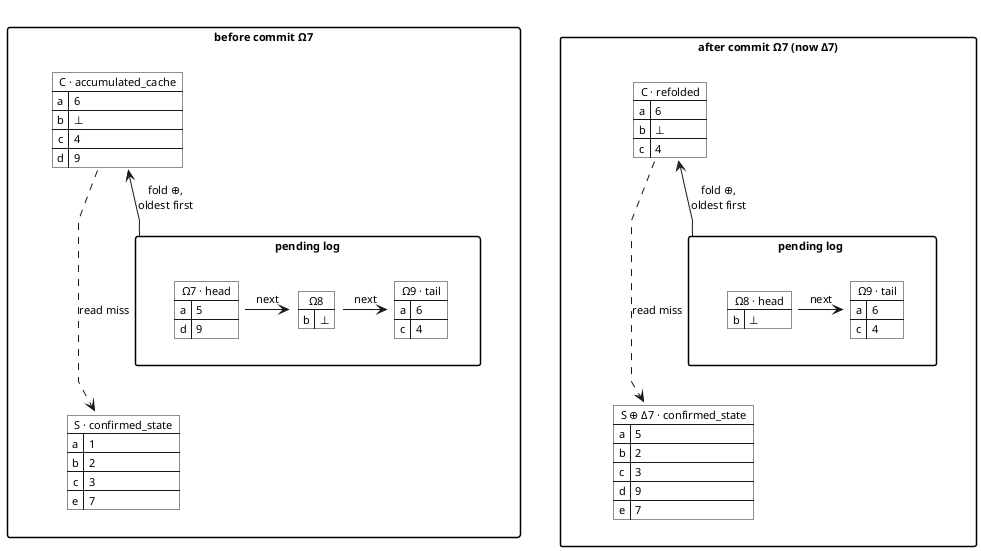
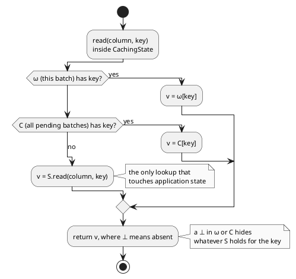
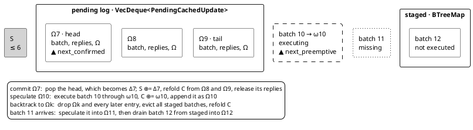

# CRUD cache: how the caching works (visualisation drafts)

Eight draft figures showing how the CRUD cache executor (`single_threaded_crud`) keeps speculative
state: one confirmed state, a small cache that holds only what pending batches wrote, and a
per-batch write log that the cache can be re-derived from. The drafts try different visual styles
so one or two can be chosen for the paper. Every figure uses the **same running example** (§2), is
grayscale-safe, and is sized with a two-column venue in mind.

**Notation.** Ωk is decision k while it is *speculated*: a pending log entry, which in the
cache executors carries the batch's write set. Δk is the same decision once consensus has
*confirmed* it: a commit turns the head Ω7 into Δ7 and applies it to `S`. Lowercase ω10 is the
private write set of batch 10 while it executes (`CachingState.delta`). It becomes Ω10 when the
batch ends. The dual-state executor's entries hold whole batches rather than write sets, but use
the same letters for the same two states.

| # | Style | Tool | Output name | Size | Fits |
|---|---|---|---|---|---|
| V1 | Three-tier read path | matplotlib | `preemptive-context-cache-read-path` | 241 × 118 pt | one column, at print size |
| V2 | The cache as the top view of the log | matplotlib | `preemptive-context-cache-structure` | 241 × 118 pt | one column, at print size |
| V3 | Storyboard: speculate, commit, backtrack | matplotlib | `preemptive-context-cache-storyboard` / `…-storyboard-2x2` | 505 × 142 pt / 241 × 284 pt | full width / one column |
| V4 | Object snapshot, before and after a commit | PlantUML | `diagrams/preemptive-context-cache-snapshot.puml` | 965 px | full width, scaled |
| V5 | Read resolution as an activity diagram | PlantUML | `diagrams/preemptive-context-cache-read-resolution.puml` | 480 px | one column |
| V6 | Sequence-number tape | PlantUML | `diagrams/preemptive-context-cache-seq-window.puml` | 775 px | one column, scaled |
| V7 | Version-control analogy | matplotlib | `preemptive-context-cache-vcs-analogy` | 505 × 100 pt | full width; better for slides |
| V8 | Memory footprint vs. dual-state | matplotlib | `preemptive-context-cache-footprint` | 241 × 98 pt | one column, at print size |

The matplotlib figures (from `figures/cache_figures.py`) are drawn **at print size**. They are laid
out in points for a 241 pt column and a 505 pt text block, with 5.8–7.5 pt type. They are written
as PDF (TrueType fonts embedded, no Type 3), SVG and a 400 dpi PNG. The PlantUML widths are
measured from PNG renders under PlantUML 1.2024.3 and need scaling.

---

## 1. What is being drawn, as the code has it

How your description of the design maps to the code, and where the code differs from it:

| Your term | Code | What it actually holds |
|---|---|---|
| confirmed state | `confirmed_state: S` | The one authoritative copy. Written only by a commit (apply a delta), direct execution, catch-up and state install. Speculation never writes it. |
| a smaller cache holding only pending information | `accumulated_cache: AccumulatedCache` | `column → key → Option<value>`, where `None` (drawn **⊥**) is a tombstone for a deleted key. It holds **only keys written by pending batches**. It is never filled from reads of `S`, so it is not a read cache. Its size is the union of the pending write sets. |
| write log | `pending: VecDeque<PendingCachedUpdate>` | One entry per speculated batch, oldest at the front. Each entry holds: **the batch itself**, its **held replies**, **Ω** (the write set) and a timestamp. Ω is the batch's *net* write set: the last value per key, with tombstones for deletes. The log is per batch, not per operation. Reads, and the order of writes inside a batch, are not recorded. |
| replay | two different mechanisms | **(a) Refold.** On every commit and every backtrack, `C` is rebuilt by folding the surviving Ωs oldest first. Nothing is re-executed. **(b) Re-execution.** The stored batch copies are sent back to the reorder buffer and speculated again. This happens only on the fallback route. |
| *(not in your description)* | `CachingState.delta` (**ω**) | The write set of the batch *currently executing*, private to it. It becomes that batch's Ω when the batch ends. |
| *(not in your description)* | `staged: BTreeMap<SeqNo, batch>` | The reorder buffer. It holds batches that arrived ahead of their turn, as inputs only: nothing has been executed and there is no Ω. |

What each operation does to the structure:

| Operation | ω | C | log | S |
|---|---|---|---|---|
| read (in a batch) | checked first | checked second | — | checked last; a ⊥ in ω or C stops the read before `S` |
| create / update / delete (in a batch) | receives the write (`delete` writes ⊥) | — | — | — |
| batch ends | becomes Ω | `C ⊕= Ω` (merge, newer wins) | append `(batch, replies, Ω)` | — |
| commit of the head | — | refold from the remaining Ωs | pop the head; release its replies | `S ⊕= Δhead`: `Some(v)` becomes `update`, ⊥ becomes `delete` |
| backtrack to *k* | — | refold from the Ωs that survive | drop entries ≥ *k*; staged ≥ *k* is also evicted | — |
| fallback (commit of a batch still in `staged`) | — | cleared | every entry's batch goes back to `staged` | the batch runs directly with `update_batch` |
| state install / catch-up | — | cleared | cleared, and `staged` cleared too | replaced / batches applied directly |
| unordered read (read pool) | — | — | — | reads `S` only; speculative values are never visible |

**Invariants the figures rely on:**

1. `C ≡ fold(Ω in log order)` at all times. This is stated in `02` §3.5, and every mutation path either merges, refolds or clears.
2. *(Inferred from the code paths, not asserted in code.)* The log covers exactly the sequence
   numbers `[next_confirmed, next_preemptive)`, contiguous and ascending.
3. *(Inferred from the code paths, not asserted in code.)* Every key in `staged` is
   `> next_preemptive`.

**Evidence:**
- `caching_state.rs`:
  - `AccumulatedCache` and ⊥: `:4-5`
  - `CachingState`: `:9-13`
  - read order: `:30-44`
  - writes into ω: `:46-75`
  - merge: `:79-86`
  - apply: `:89-102`
  - refold: `:105-113`
- `pending_state.rs`:
  - `PendingCachedUpdate`: `:33-42`
  - fields: `:81-93`
  - speculate: merge `:217`, append `:219-224`
  - commit route: `:248-253`
  - apply `:312`, refold `:316`
  - fallback: `:257-276`, `:326-356`
  - direct commit: `:361-381`
  - catch-up: `:386-404`
  - install: `:409-416`
  - backtrack: `:422-452`
- `single_threaded_crud/mod.rs`:
  - unordered reads on `confirmed_state()`: `:291-316`
  - backtrack, then retry: `:337-345`

---

## 2. Running example

Every figure draws this one state, taken just after batches 7, 8 and 9 were speculated.
There is one column (the benchmark uses a single `CRUD_COLUMN`), and the keys are `a`–`e`.

| | a | b | c | d | e | Meaning |
|---|---|---|---|---|---|---|
| S (through seq 6) | 1 | 2 | 3 | | 7 | |
| Ω7 (head) | 5 | | | 9 | | update a, create d |
| Ω8 | | ⊥ | | | | delete b |
| Ω9 (tail) | 6 | | 4 | | | update a, update c |
| **C = Ω7 ⊕ Ω8 ⊕ Ω9** | 6 | ⊥ | 4 | 9 | | |

`next_confirmed = 7`, `next_preemptive = 10`, and `staged = {12}` (11 has not arrived).

Batch 10 is `c ← 5, e ← 8, read e, read b` (operations o1–o4). This batch is the one every
executor runs. On the scalable executor it collides: o2 writes `e` and o3 reads it. V1 (read
path) alone uses its own mid-batch illustration: `read a → 6` (from C), `read b → absent` (a ⊥ in
C hides `S`'s 2), `read e → 7` (from S), and `update(c, 5)`, which goes into ω only.

All numbers come from `figures/executor_model.py`, a small executable model of the three
executors. Its self-checks assert the states below.

The storyboards continue the example:
1. **Speculate Ω10:** `Ω10 = {c:5, e:8}`. The held replies are `4, 7, 8, none`.
2. **Commit Ω7:** `S` becomes `{a:5, b:2, c:3, d:9, e:7}`, and `C` is refolded to `{a:6, b:⊥, c:5, e:8}`.
3. **Backtrack to Ω9:** Ω9 and Ω10 are dropped, `staged {12}` is evicted, and `C = Ω8 = {b:⊥}`.

---

## 3. Visual vocabulary (matplotlib figures)

| Mark | Meaning |
|---|---|
| white cell, black outline | entry in `S` |
| light-gray cell | entry in a log Ω (speculated) |
| dark cell, white text | entry in `C` |
| dashed cell | entry in the executing batch's ω |
| empty column slot (only a faint column guide) | no entry, so the read falls through |
| ⊥ | tombstone (the key was deleted) |
| gray text | entry shadowed by a newer layer; a read never sees it |
| **bold outline** | the cell a read stops at, or a cell that changed in this step |
| dashed outline, gray text | an entry removed in this step |
| row struck through | a log entry dropped by a backtrack (an applied entry is dashed but not struck) |
| thick horizontal rule | commit frontier: everything below it is in `S` |
| italic math | layers ($S$, $C$, $\Delta_7$, $\delta_{10}$) and keys ($a$–$e$) |
| gray mono | code identifiers |
| $n_c$, $n_p$ | `next_confirmed`, `next_preemptive` (storyboard footers) |

The PlantUML figures use the shared style header of [README.md](README.md) (§0).

---

## V1 — Three-tier read path

One batch's view of the structure: ω over C over S. Plumb lines show where each read stops. The
write arrow shows that a write never goes below ω. This is the "overlay filesystem" picture,
aimed at readers who need to know *what a read returns* and nothing about the log.

- **Strengths:** It is the smallest figure that explains the tombstone. `read b` stops at ⊥ even though `S` still holds `b = 2`. It has no time dimension.
- **Weaknesses:** It hides the log entirely, so `C` looks like a primary structure rather than a derived one.

**Evidence:** `caching_state.rs:30-44` (read order), `:46-75` (writes into ω only).

## V2 — The cache is the top view of the log

The log's Ω rows are stacked above `S`, newest on top. Each `C` entry has an arrow up from the
newest row that holds its key, so `C` is literally "look down each column; the first entry wins".
Shadowed values (Ω7's `a = 5`, and `S`'s `a`, `b`, `c`) are gray.

- **Strengths:** It shows that `C` is a *materialised view* of the log, which is the relationship behind both "smaller" and "replay". A reader can re-derive `C` by eye. Its row geometry is also the storyboard's.
- **Weaknesses:** It shows no operation. The ω tier is left out, because it would be one more row above `C` and blur the picture.

**Evidence:** `caching_state.rs:105-113` (fold, later deltas override), `pending_state.rs:217` (merge on speculate), `:316` (refold on commit).

## V3 — Storyboard: speculate, commit, backtrack

Four panels in V2's layout (0 start, 1 speculate Ω10, 2 commit Ω7, 3 backtrack to Ω9), as a 1 × 4
strip for full width and as a 2 × 2 block for one column. Each panel
shows the sequence pointers and what happened to replies and `staged`. This is the figure for the
claims that a commit is "apply a delta and refold" and a backtrack is "truncate and refold".
- **Panel 2** shows `d` leaving `C` when Ω7 is confirmed as Δ7 and reaches `S`: `C` shrinks on a commit.
- **Panel 3** shows Ω8 surviving the backtrack without re-execution.

- **Strengths:** It shows the dynamics and the cost argument in one place. Every cell can be checked against §2.
- **Weaknesses:** The strip needs full width, and the 2 × 2 block is tall for a column. There are many cells to keep consistent, which is why it is generated from the §2 data rather than hand-drawn.

**Evidence:** `pending_state.rs`:
- speculate: `:198-225`
- commit: `:291-321`
- backtrack: `:432-447`, including `staged` eviction `:437-438`

## V4 — Object snapshot, before and after a commit

A UML object diagram built from PlantUML `map`s. Each structure is a key→value table, the log is
a package of Ω maps linked by `next`, and `C` is labelled as a fold of the log.

- **Strengths:** It is plain UML, so it sits naturally next to the class diagrams in `02` and `M2`, and it is a text source that diffs well.
- **Weaknesses:** PlantUML chooses the placement. There is a lot of white space, and the layout cannot be made to line keys up across maps the way V2 does.

**Evidence:** as V2, plus `pending_state.rs:312` (`apply_delta_to_state`).



## V5 — Read resolution as an activity diagram

The read order as a vertical decision ladder with a single exit. It is the most compact precise
statement of the read semantics, and could replace the table in `02` §3.2 or sit beside V1.

- **Strengths:** It fits one column at its natural size and is unambiguous.
- **Weaknesses:** It is purely procedural, with no data shown.

**Evidence:** `caching_state.rs:30-44`.



## V6 — Sequence-number tape

The executor's view as one axis of sequence numbers:
- `S` holds everything up to 6;
- the log holds 7–9;
- batch 10 is executing;
- 11 is missing;
- 12 waits in `staged`.

The `next_confirmed` and `next_preemptive` pointers mark where a commit pops and where speculation
appends, and the legend lists what each operation does to the tape.

- **Strengths:** It is the only draft that places the log next to the reorder buffer, and it explains why `staged` holds inputs only.
- **Weaknesses:** It shows no key-level content. It pairs with V2 or V3 rather than replacing them.

**Evidence:** `pending_state.rs:81-93` (the fields), `:156-179` (stage when ahead), `:185-188` (drain), `:437-438` (evict on backtrack).



## V7 — Version-control analogy

Filled commits are `main` (= `S`), outlined commits are the unmerged log, the dashed commit is the
working tree (= ω), and `HEAD`'s view is `C` over `S`. The rows map each operation to a git
operation:
- commit is a fast-forward by one (Ω7 becomes Δ7);
- backtrack is `reset --hard` and then a new commit;
- state transfer replaces `main`.

- **Strengths:** Readers familiar with git get the idea in one glance, which makes it good for slides and talks.
- **Weaknesses:** The analogy is loose in one place that matters. Git replays commits by re-applying them, while here a refold re-applies Ωs and never re-executes a batch. The figure says so in the backtrack row, but a reviewer could still read "rebase", so it is risky as the only figure in a paper.

**Evidence:** as V3. For state transfer: `pending_state.rs:409-416`.

## V8 — Memory footprint vs. dual-state

Two panels:
- dual-state: two full copies of `S`;
- CRUD cache: one `S`, a small `C` and a strip of Ωs.

The commit and backtrack cost is written under each.

- **Strengths:** A motivation figure; it states the paper's argument visually.
- **Weaknesses:** Schematic and **not to scale**. The size of `C` depends on how many distinct keys the pending window writes, and the figure says so. Both designs also keep each pending batch and its held replies. The dual-state worker's `PendingPermanentUpdate` has the same `batch` and `replies` fields (`preemptive_requests.rs:20-28`), so the figure must not suggest the CRUD cache saves that part.

**Evidence:** `single_thread_double_state/preemptive_worker/preemptive_requests.rs:20-28`; `02` §7 (cost model).

---

## Flow figures — routes B and C with arrows, for all three executors

Routes B (containers) and C (tables) are developed further here. Arrows show where data moves in
each step, and every step lists the state changes it makes explicitly (for example
`S: a 1→5, d +9`). The same routes are drawn for the dual-state and scalable executors. All
figures come from `figures/executor_model.py`, so the three executors run the same workload.

| Figure (output name) | Script | Size | Idea |
|---|---|---|---|
| `preemptive-context-cache-flow-b1-containers-arrows` | `crud_flow.py` | 505 × 328 pt | B as a 2 × 2 storyboard. Each step draws its flows: batch 10 *executes* into Ω10, which *merges* into C; *apply* Ω7 into S, with replies → clients; rows *dropped*, then *refold*. A change list sits beside each step. |
| `…-cache-flow-b2-before-after` | `crud_flow.py` | 505 × 378 pt | One row per operation: the state before (what the step consumes is outlined), a long arrow carrying the operation and its bullet list of changes, and the state after (changed cells in bold, removed ones dashed). |
| `…-cache-flow-b3-mechanism` | `crud_flow.py` | 241 × 172 pt | A single-column map with five numbered flows: execute into ω; reads ω → C → S, skipping the log; ω appended as Ω and merged into C; commit of the head into S; the backtrack cut. Here C sits *above* the log, so the head commits straight down into S. |
| `…-cache-flow-c1-table-arrows` | `crud_flow.py` | 505 × 234 pt | C as a 2 × 2 storyboard. Arrows run along each key's row, from the newest log entry into C (fold/merge) and from Ω7 back across the double rule into S (commit). S cells show their transition in place (old value struck, new value in bold). |
| `…-cache-flow-c2-timeline` | `crud_flow.py` | 505 × 146 pt | One table over time: S and C side by side after every step, with the operations as arrows between the column groups and the log and reply status as footer rows. It makes visible that only a commit changes S. |
| `preemptive-context-dual-flow-b-containers-arrows` | `dual_flow.py` | 505 × 328 pt | B for the dual-state executor: preemptive worker (the log of *batches* and the full copy S_p) over confirmed worker (S). Flows: execute on S_p in place; forward B7 to be re-executed on S; clone S into S_p (blocking), then replay B8. |
| `…-dual-flow-c-timeline` | `dual_flow.py` | 505 × 146 pt | C2 for the dual-state executor: S and S_p (both full states) after every step. |
| `preemptive-context-scalable-flow-b-two-layers` | `scalable_flow.py` | 505 × 250 pt | The two caching layers as nested bands: the cross-batch layer (log and C) above the intra-batch workspace (steps ① to ⑤ for batch 10), above S. Arrows cross between the layers: every unit reads C, C is copied into the view, Ω10 is appended and merged into C, and misses fall to S. |
| `…-scalable-flow-c-table` | `scalable_flow.py` | 505 × 160 pt | C for the scalable executor. The intra-batch layer becomes extra column groups: per-operation local caches, the collision row, ω10 after pass 1, the re-runs of pass 2, then Ω10 and the C after. |
| `…-scalable-flow-d-middleware` | `scalable_flow.py` | 505 × 286 pt | Three bands, left to right: the speculated view (C over S, read only), the middleware (one container per operation: four in parallel on T1–T4, then the two collider re-runs on the worker), and the decision state (collision check, ω10, Ω10). Dashed arrows run from the exact cell that serves each read into its container; solid arrows carry each container's output to the join and into ω10. |
| `…-scalable-flow-e-thread-lanes` | `scalable_flow.py` | 505 × 222 pt | A Gantt-style strip over time: the request channel, the worker, the exec pool (T1–T4) and the read pool. It shows the fork–join of step 1 with the worker blocked in `pool.install`, steps 2–5 and the commit on the worker, Finalized(7) and batch 11 waiting in the channel, and unordered reads on S. |
| `…-scalable-flow-f-request-routing` | `scalable_flow.py` | 505 × 226 pt | Every request type the worker accepts and the path it takes: PreemptiveUpdate (stage, speculate and drain, or backtrack), Finalized (commit, or the staged fallback), UpdateBatch, ExecuteUnordered, CatchUp and PollStateChannel. Each step carries its thread tag. |
| `…-scalable-flow-g-request-journey` | `scalable_flow.py` | 241 × 318 pt | A single-column trace of two client requests, o2 (`e ← 8`) and o3 (`read e`): their parallel containers and read paths, the collision, the re-runs on the worker, Ω10, the commit, and the replies their clients finally get. |
| `…-scalable-flow-h-layer-cake` | `scalable_flow.py` | 505 × 196 pt | One column per container, with rows for the layers: the private ℓ, ω10 (worker only), C and S (shared, read only). Each read is a vertical arrow that stops at the layer serving it, which makes the lock-free argument visible: private and mutable versus shared and immutable. |

**Labelling** (from iteration 02). An action names the decision it acts on:
- Ωk while the decision is speculated: `speculate Ω10`, `commit Ω7`, `backtrack to Ω9`.
- Δk once consensus has confirmed it. A commit turns Ω7 into Δ7, which is applied to `S`
  (`S ← S ⊕ Δ7`), and the replies sent are Δ7's.

The dual-state executor follows the same rule even though its entries hold batches, not write
sets. A staged batch is not a decision yet, so it stays "batch 12".

**Dual-state, as the figures draw it:**
- *Speculate.* The batch runs directly on S_p, the preemptive worker's full copy (`preemptive_state`).
- *Commit.* The head's replies go to clients from the preemptive worker. The batch is forwarded
  to the confirmed worker, which re-executes it on S and discards the replies.
- *Backtrack.* S_p is replaced by a clone of S, fetched with a blocking request, and every
  survivor is re-executed, so its replies are recomputed.
- *Evidence:* `preemptive_worker/mod.rs:131-149` (commit), `:249-265` (backtrack request);
  `preemptive_worker/preemptive_requests.rs:137-171` (clone, then replay);
  `confirmed_worker/confirmed_requests.rs:44` (re-execution).

**Scalable, the two caching layers.**
- *Cross-batch layer.* The log of Ωs and its fold C, identical to the CRUD cache. Commit and
  backtrack are the CRUD cache's, so B1, B2, C1 and C2 apply unchanged.
- *Intra-batch layer.* Rebuilt for every batch. It holds:
  - one local cache ℓ per operation, which reads ℓ, then C, then S and records every access;
  - the collision set, where a Write or Delete on the same key as any other access collides;
  - `batch_delta`, the batch's write set while it executes, drawn as ω10 (the figures before
    iteration 03 called it bd): first the non-colliders' ℓs merged in batch order, then each
    collider re-run's writes;
  - `current_view = C ⊕ ω10`, over which the colliders re-run one at a time, in batch order,
    each through its own `CachingState`.

  The final ω10 *is* Ω10.
- *Evidence:* `scalable_crud/execution_unit.rs:17-113` (the unit), `:140-167` (collisions);
  `scalable_crud/pending_state.rs:225-240` (parallel pass), `:262-270` (pass 1), `:272-285`
  (pass 2), `:294-301` (append and merge).

Ideas used to fit the second layer into the chosen styles:
- **Containers.** Nest the layers as bands, with the workspace between C and S because that is
  where it reads from. Draw the batch pipeline left to right inside the workspace. Stack the
  parallel units as lanes, and draw the collision as a dashed box around the offending accesses.
- **Tables.** Keep one row per key and add the workspace as further column groups, read left to
  right in pipeline order. The collision is a box across the two cells, and the corrected read
  (`r 7` → `r 8`) sits in the same row, so the fix is visible at a glance.

**Scalable, threads and containers** (figures D–H, from iteration 03):
- *Threads.*
  - One worker thread takes every request from the channel and handles them one at a time.
  - Step ① alone runs on the exec pool (rayon, 4 threads). It is a fork–join: the worker
    blocks in `pool.install` until the slowest operation finishes.
  - Steps ②–⑤, the collider re-runs, commit and backtrack all run on the worker.
  - Unordered reads run on a separate 4-thread read pool, directly over S, with no container.
- *Containers.* Each operation executes inside a proxy that implements `CRUDState`. The
  application's `speculatively_execute(&mut impl CRUDState, op)` never touches S or C itself.
  The proxy sits between the speculated view and the decision being built: it reads its own ℓ,
  then C, then S, and writes only into its own ℓ, which the worker then folds into ω10.
  - In step ① the proxy is a `ParallelExecutionUnit` and also logs every access.
  - In step ④ it is a `CachingState` over `current_view`.
- *Figure conventions.*
  - Containers have a double border.
  - Thread tags: black T1–T4 for the exec pool, white W for the worker, grey R1–R4 for the read
    pool.
  - Hatching marks the sections that run in parallel.
- *Evidence:*
  - `scalable_crud/mod.rs:42-44` (pool sizes), `:154-164` (the worker thread),
    `:298-319` (unordered reads on the read pool);
  - `scalable_crud/pending_state.rs:225-235` (`pool.install`, one unit per operation),
    `:273-284` (re-runs in a `CachingState` over `current_view`);
  - `Atlas-SMR-Execution/src/crud_states.rs:31-35` (`speculatively_execute` takes
    `&mut impl CRUDState`).

Ideas considered and not drawn yet:
- a conflict graph (operations as nodes, collisions as edges) for batches with more than one
  collision.

## V3 alternatives — separating the confirmed state from the pending cache

The storyboard (V3) puts `S`, the log and `C` in one shared grid. The only thing separating the
confirmed state from the speculative state is a thin rule, so readers take `C` and `S` to be
peers. Six alternative routes, all generated by `figures/storyboard_alternatives.py` from a small
model of `CachingPreemptiveState`. The script asserts the model's states against §2, so the
alternatives cannot drift from each other.

| Route | Output name | Size | How it separates the two | Trade-off |
|---|---|---|---|---|
| **A. Swimlanes** | `preemptive-context-cache-alt-a-swimlanes` | 505 × 244 pt | Two lanes run top to bottom: *confirmed* (white, solid) and *speculative* (gray, dashed). Time runs down, one row per step. The log's cards line up by sequence number, with the head next to the lane boundary, and the commit arrow crosses into `S`. | The clearest separation and the only route showing each Ω as a write set (`a ← 5`). It is tall. |
| **B. Containers** | `…-alt-b-containers` | 505 × 176 pt | The current storyboard, with the log and `C` boxed as *pending · discardable* above a separate *confirmed · authoritative* box. A `commit ↓` gate between them is active only in step 2. | The smallest change from V3. The shared key columns still invite comparing `C` with `S` cell by cell. |
| **C. Version table** | `…-alt-c-version-table` | 505 × 112 pt | One row per key, read left to right as that key's history: the confirmed value, then the pending writes in order, then `C` (the last one). A double rule separates *confirmed*. | The most compact, and the most paper-like (a booktabs table). Backtrack shows as struck columns. There are no arrows, so the reader must know what refold means. |
| **D. Version chains** | `…-alt-d-version-chains` | 241 × 160 pt | A single picture, not a storyboard. Each key is a chain `S → Ω7 → Ω9 …`, and the dark cell is the newest pending version, which is *exactly* what `C` holds. Commit is the frontier line moving right; backtrack is a cut. | Fits one column and shows that `C` is not a separate copy of anything. It is MVCC-flavoured, which suits database-minded reviewers. The operations are described rather than shown step by step. |
| **E. Pipeline** | `…-alt-e-pipeline` | 505 × 124 pt | Batches flow left to right: consensus, the executing batch (ω), the *speculative* region (log cards and `C`), then `commit` into a *confirmed* store drawn as a database. | Presents the design as a system rather than a data structure, and is the only route that places the reorder buffer and the executing batch. A single state, no storyboard. |
| **F. Transparent sheets** | `…-alt-f-sheets` | 505 × 158 pt | `S` is a solid base sheet below the commit frontier. Each Ω is a gray sheet stacked above it, and looking down a column gives what a read returns. Commit fuses the lowest sheet into the base; backtrack lifts the top sheets away. | The most intuitive "overlay" metaphor. The isometric sheets cost width, and values on a slanted sheet are harder to scan than a grid. |

Nothing is committed to yet. The routes combine well: D or E as the structural figure, plus A or C
for the dynamics.

## 4. Suggested combinations

These are only suggestions; nothing is committed to yet.
- **Paper, one full-width figure:** V3 alone. It carries the structure and all three operations.
- **Paper, two single-column figures:** V2 for the structure and V5 for the read semantics. Add V1 if the tombstone needs its own picture.
- **Paper, with the reorder buffer in scope:** V6 above V2.
- **Talk:** V8, then V1, then V7.

---

## 5. Findings while reading for these figures

Everything here is **inferred from reading the code**. None of it was reproduced, and none of it
is drawn as fact in the figures.

1. **Refolding on commit is space reclamation, not a correctness requirement.** After `S ⊕= Δhead`, every `C` entry that came from Δhead now equals the value in `S`, or is overridden by a later Δ. So reads would return the same values without the refold, which only shrinks `C`.
   - The refold costs O(Σ|Ω|) on every commit (`pending_state.rs:316`).
   - This refines `02` §7. That section is right that *removing* the head's contribution needs per-key provenance, but it does not say that the removal is optional for correctness.
   - It is recorded here, not as a contradiction.

2. **A commit turns a `create` into an `update`.**
   - `apply_delta_to_state` writes every `Some(v)` with `state.update` (`caching_state.rs:93-95`). A key created speculatively therefore reaches `S` only if `update` inserts missing keys.
   - `CRUDState::update` does not document that behaviour (`crud_states.rs:13-15`).
   - Both implementations in the workspace do insert (`crud_perf_exec/src/serialize/mod.rs:120-122`, `tests/test_fixtures.rs:48-50`). A third-party `CRUDState` might not.
   - Separately, the benchmark application maps `Create` to `state.update` (`crud_perf_exec/src/exec.rs:130-133`), so the "fails if present" branch of `CachingState::create` is never exercised by the benchmark.

3. **The fallback route runs only with an empty log, so `discard_speculation` discards nothing there.**
   - By invariant 2, a non-empty log always has `next_confirmed` at its head, which is the `Pending` route. So `ConfirmRoute::Staged` (`pending_state.rs:250`) can only be taken when the log is empty.
   - The one way I found into it: `handle_confirmed_update` advances both counters without draining `staged` (`:377-378`, unlike `execute_directly` `:338-340`). If the next batch was already staged, it stays unspeculated, as does everything after it, until its own commit arrives and takes the fallback.
   - No unit test exercises this route (`tests/unit_tests.rs` has no `Staged`-route or fallback test).
   - The figures therefore do not draw a fallback panel. V7 uses state transfer as its fourth row instead.

4. **On the worker's path, a backtrack empties `staged` completely.**
   - The worker calls `backtrack(seq)` only when `seq < next_preemptive` (`pending_state.rs:156-158`, `mod.rs:337-338`), and every staged key is above `next_preemptive` (invariant 3). So `retain(< seq)` keeps nothing.
   - A direct call can keep entries, as the unit test at `tests/unit_tests.rs:446` shows. V3 panel 3 draws the worker's case.

5. **Terminology.**
   - `02` §1 says a backtrack needs "no clone, no replay", meaning no re-execution. Your framing calls the refold a replay of the log.
   - Both are accurate, but the paper should pick one word. These drafts say *refold* for (a) and *re-execute* for (b) (§1).

6. **Scalable: a collider's re-run can see writes from later operations in the batch.**
   (Inferred; not reproduced.)
   - Pass 2 re-runs each collider over `C ⊕ ω10`, and ω10 (`batch_delta`) already holds *every* non-collider's
     writes, including those of operations *after* the collider in batch order
     (`scalable_crud/pending_state.rs:272-285`).
   - A non-collider's keys were touched by no other operation *in the parallel pass*, so this
     is safe when an operation's access set does not depend on the values it reads.
   - If an access set is data-dependent, a re-run could read a key it did not read in parallel,
     and see a later operation's write. The re-run's accesses are not checked again.
   - The benchmark's operations each touch one fixed key, so they cannot hit this.

7. **Scalable: every batch copies the whole cross-batch cache.**
   - `current_view = self.accumulated_cache.clone()` runs for every batch, even when there are no
     colliders (`scalable_crud/pending_state.rs:273`).
   - That costs O(|C|) per batch on top of the CRUD cache's refold cost.

8. **Dual-state backtrack keeps its reorder buffer; the cache executors' backtrack clears it.**
   - `backtrack` in `preemptive_requests.rs:137-171` does not touch `staged`.
   - The CRUD cache evicts staged batches at or above the backtrack point (`pending_state.rs:437-438`).
   - The dual-state figures therefore say nothing about batch 12 on a backtrack.

9. **A confirm rebuilds the cache, but only a backtrack needs to.** (The intended design, drawn from
   figure iteration 15 on.)
   - The code rebuilds the cache from the remaining log on every confirm:
     `single_threaded_crud/pending_state.rs:316` and `scalable_crud/pending_state.rs:390` call
     `rebuild_accumulated_cache(self.pending…)` after `apply_delta_to_state`.
   - **Why the rebuild is unnecessary.** After Δk is applied, Ω\* still holds Ωk's writes, but each
     of them is either equal to Δ\*'s value or overridden by a newer pending write. Reads (ω, then
     Ω\*, then Δ\*) therefore return the same values without it. Only a backtrack, which drops
     entries, needs a refold.
   - **The hazard to handle if the rebuild is removed.** Ω\* can then hold confirmed entries while
     the log is empty. A path that writes Δ\* without going through the log would be shadowed by
     those stale entries. Two paths do that:
     - `handle_confirmed_update`, which only requires an empty log;
     - the `ConfirmRoute::Staged` fallback.

     Both must clear Ω\* first. Clearing Ω\* whenever the log drains also keeps it from growing
     without bound.

## 6. Could not be determined from the code

- Typical sizes of `C` and of Δ in the recorded runs. The size metrics exist as `CACHE_DELTA_SIZE` and `CACHE_PENDING_QUEUE_SIZE` (`pending_state.rs:306-309`). There is no metric for the size of `C`, so V8 cannot be drawn to scale from the code alone.
- Whether the fallback route (finding 3) has ever fired in a recorded run. `SPECULATION_FALLBACK_COUNT` would say (`pending_state.rs:263`).

---

## Rendering and editing

**PlantUML (V4–V6).** The fenced blocks above are the source of truth. They are extracted into
`diagrams/` by the same script as in [README.md](README.md#rendering-and-keeping-the-copies-in-sync),
and rendered with `diagrams/render.sh`.

**matplotlib (V1–V3, V7, V8).** `figures/cache_figures.py` holds the running example and one
function per figure. `figures/paperfig.py` holds the print-size canvas: coordinates in points,
the grayscale ramp and the font setup (Helvetica or Arial, with STIX as the fallback for ⊕ and ⊥).
Rendered files are not kept in the repository; write them wherever the paper needs them:

```bash
python3 -m venv .venv && .venv/bin/pip install -r docs/context/figures/requirements.txt
cd docs/context/figures && for f in cache_figures storyboard_alternatives crud_flow dual_flow scalable_flow; do ../../../.venv/bin/python $f.py <output-dir>; done
```

Each figure is written as `<name>.pdf` (for LaTeX, `\includegraphics` at 100 %), `<name>.svg` and
`<name>.png`.
- The flow figures (`crud_flow.py`, `dual_flow.py`, `scalable_flow.py`) take every value from
  `executor_model.py`. Change `S_INIT` or `BATCH` there and they all follow; the model's
  `_check()` then has to be updated with the new expected states.
- `cache_figures.py` and `storyboard_alternatives.py` predate the model and carry the same
  numbers in their own constants.
